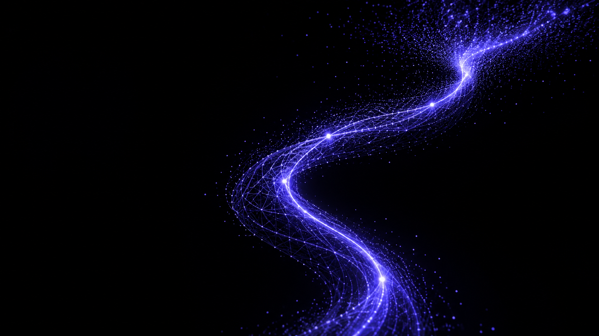
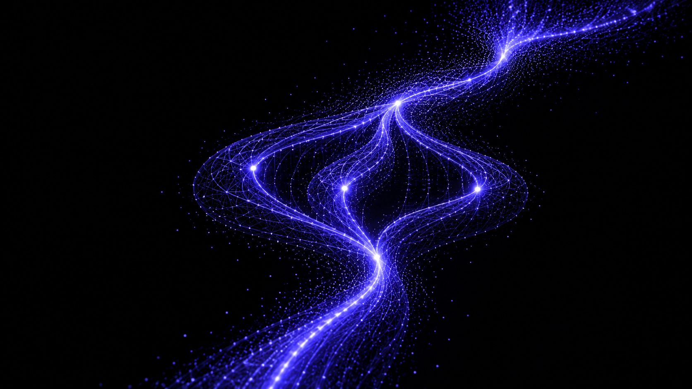
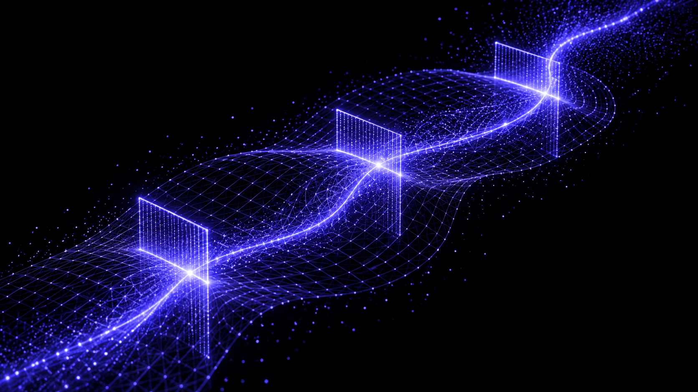
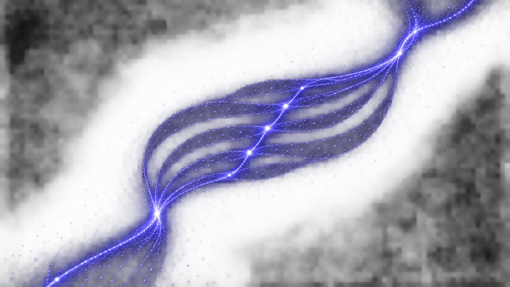
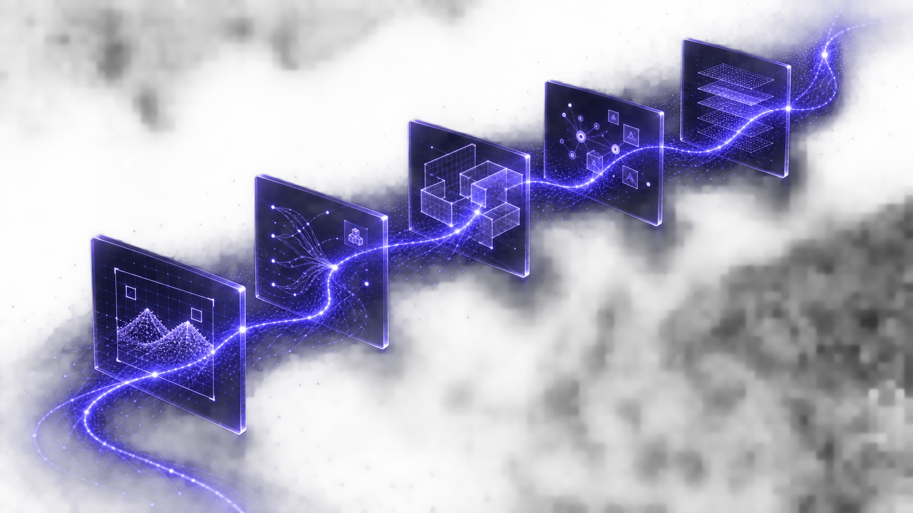
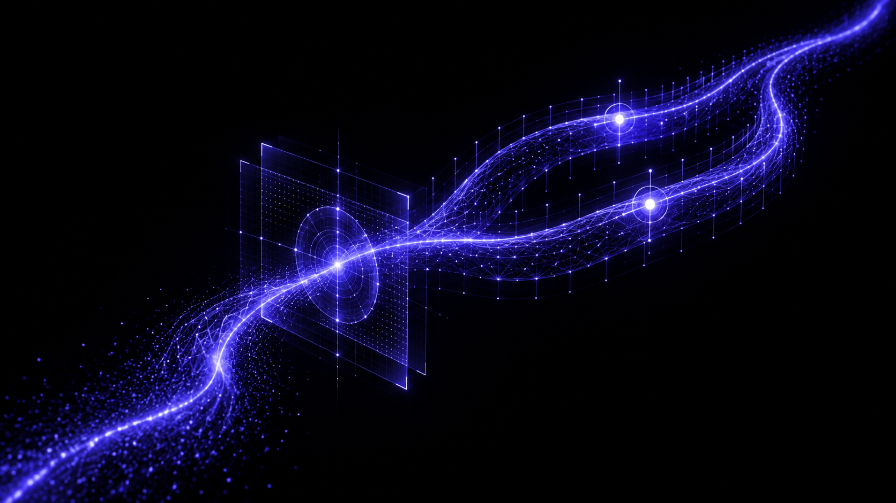
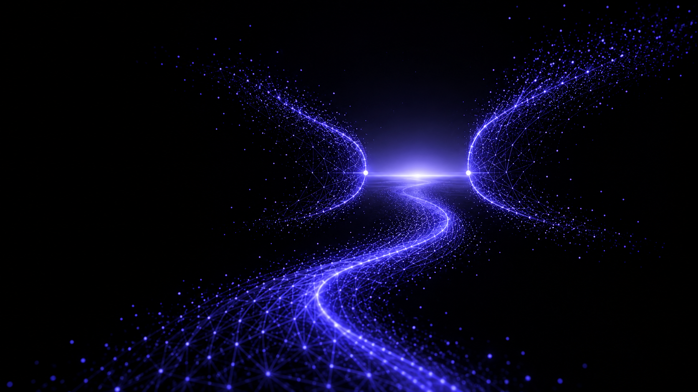

# Signal → Structure — sette keyframe

Questa sequenza di concept visivi sviluppa la direzione **Signal to Structure**
già scelta. Ogni immagine rappresenta una fase concreta del portfolio, ma la
traiettoria luminosa, la mesh fine e il trattamento violetto restano coerenti:
sono keyframe della stessa animazione, non sette illustrazioni indipendenti.

Le immagini sono reference di art direction, non asset runtime. La scena del
sito va ricostruita in Three.js/shader e deve interpolare continuamente tra le
forme; non va composta alternando questi PNG durante lo scroll.

| # | Sezione reale | Evoluzione visiva |
| --- | --- | --- |
| 01 | Intro / Segnale | Una nube di punti prende forma in una corrente luminosa a S. |
| 02 | Profilo | La corrente si ramifica in percorsi ordinati che poi si ricongiungono. |
| 03 | Formazione | La mesh diventa una superficie di misura attraversata da tre scansioni. |
| 04 | Competenze | Il segnale si apre in cinque strati collegati da una spina comune. |
| 05 | Progetti | Cinque artefatti software emergono dal medesimo percorso e dalla stessa mesh. |
| 06 | Esperienza | Il flusso attraversa la computer vision e si organizza in canali di delivery. |
| 07 | Contatto | La traiettoria rallenta e si apre in un passaggio luminoso, lasciato aperto. |

## Keyframe

### 01 — Segnale

### 02 — Profilo

### 03 — Formazione

### 04 — Competenze

### 05 — Progetti

### 06 — Esperienza

### 07 — Contatto

## Prompt set

Le sette immagini sono state generate con `image_gen` come concept art WebGL
16:9, usando la reference **Signal to Structure** come guida di stile e il primo
keyframe come ancora di continuità. Tutti i prompt richiedono fondo nero,
indaco/violetto, una corrente/mesh persistente, assenza di copy e UI, e un'unica
forma che cambia funzione in base alla sezione:

1. Segnale: nube di particelle che si raccoglie in una corrente a S.
2. Profilo: corrente che si organizza in percorsi di sistemi e integrazioni.
3. Formazione: superficie di misura e tre scansioni che richiamano ricerca e
   computer vision.
4. Competenze: cinque strati intrecciati e uniti da una spina comune.
5. Progetti: cinque artefatti distinti — visione artificiale, commercio,
   geometria di aule, raccomandazione e contenuti — legati al flusso.
6. Esperienza: passaggio dalla scansione di computer vision a canali di
   delivery con due checkpoint.
7. Contatto: corrente rallentata che si apre in una soglia asimmetrica e
   attraversabile, senza nucleo chiuso.
